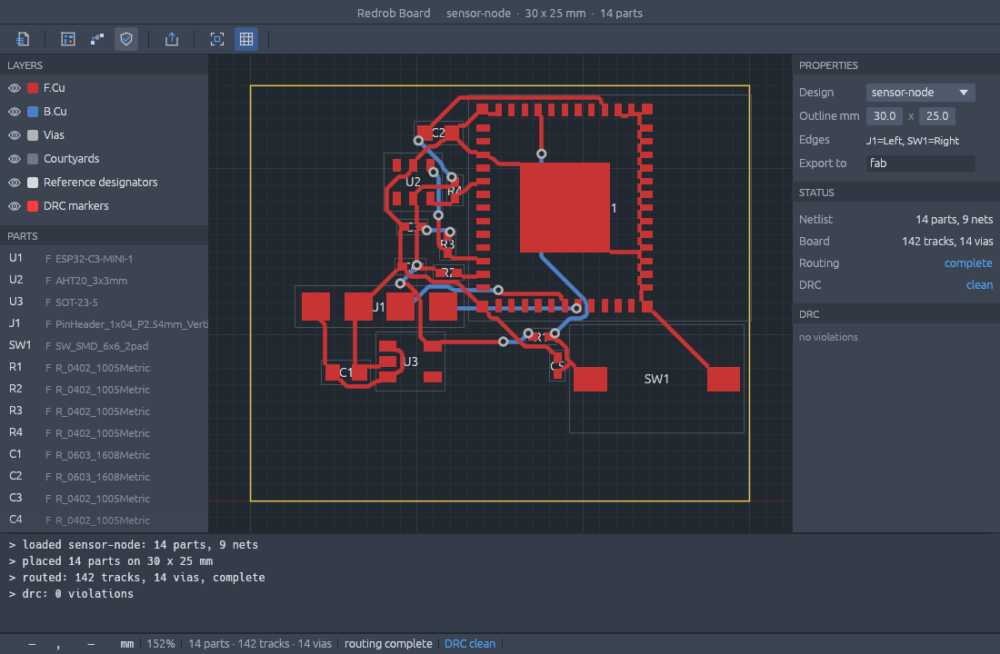

# Redrob Board

Redrob Board is an agentic PCB design studio that takes a spoken spec to a factory-ready board.

한국어: [README.ko.md](./README.ko.md)



## What it is

One Rust workspace, built from scratch, that goes from a circuit written in Rust to the Gerber,
drill, BOM and pick-and-place files a PCB factory manufactures from, with an agent driving every
step:

- **board-units** -- integer nanometre lengths. No floating point decides geometry.
- **board-geom** -- exact points, rectangles, segments and polygons.
- **board-netlist** -- the intermediate representation every tool shares, with validation that
  reports every problem at once.
- **board-schematic** -- a schematic is Rust code: add parts, wire pins, get a netlist. A drawn
  schematic is a view of that netlist, never the source of truth.
- **board-layout** -- the board itself: layer stack, outline, placed footprints, tracks, vias.
- **board-gerber** -- RS-274X writer and reader; CI proves every export round-trips.
- parts library, DRC, placement, push-and-shove routing, drill/BOM/pick-and-place export, circuit
  simulation, the egui app and the agent tools follow, each as its own crate (see
  [docs/ROADMAP.ko.md](docs/ROADMAP.ko.md)).

Redrob Silicon designs the inside of a chip; Redrob Board designs the board the chips sit on. The
two share one flow (netlist -> place -> route -> check -> manufacturing files) and will share
geometry, DRC and viewer code.

No JavaScript, no web view, no external EDA binaries. Upstream tools (KiCad, ngspice) are used only
as test oracles in CI: our DRC count and our rendered Gerbers must match theirs before a stage is
called done. Nothing of theirs ships in the product. See [UPSTREAM.md](./UPSTREAM.md).

## Build from source

```sh
cargo test --workspace
cargo run -p board-agent --bin board-cli -- pipeline --design sensor-node --outline 30x25 --edge J1=left --edge SW1=right --out fab
cargo run -p redrob-board         # the desktop app
```

## Status

Stages 0 (bootstrap), 1 (footprint library, DRC), 2 (placement), 3 (routing), 4 (manufacturing
files) and 5 (app) done. The `oracle` workflow
exports the fixture boards to KiCad and requires KiCad's DRC counts to equal ours: clearance,
track width, annular ring, drill size, shorts and unconnected items agree on four fixtures, front and
back side. The placer puts the 14-part sensor node down with no courtyard overlap and 54% less
wire length than the hand placement it is measured against (gate: 20%). The router completes the
divider and both sensor-node placements on two layers with zero DRC violations, and KiCad agrees
the routed sensor node is clean. Our Gerbers (copper, mask, paste, edge cuts) and Excellon drill
files are compared with KiCad's plots of the same boards by rasterising both at 10 um with our own
reader: 48 of 48 copper, mask, paste (with the grid of paste windows on the module ground plate), edge and drill files are pixel-identical, and the silkscreen (reference designators in our own stroke font) matches KiCad's loosely -- same place, same mirror, same ink within a factor of two. BOM and pick-and-place CSVs come from `board-bom`.
`board-cli pipeline --design sensor-node --outline 30x25 --edge J1=left --edge SW1=right --out fab`
runs the whole flow and exits 0 only when routing is complete and DRC is clean; `redrob-board`
(egui) does the same from buttons, and a headless `egui_kittest` test drives those buttons and
compares the rendered frame to `crates/app/tests/snapshots/sensor_node_routed.png`. The app's
AGENT palette talks to the shared Redrob Code engine (`redrob-engine-client`) with ten caller-owned
tools (`board-agent`: catalog, write_schematic, place, route, drc, export_zip, ...): the engine
names a tool, the app runs it on the open design. A spec -- MCU, I2C sensors, power, extras --
becomes a netlist by rules (`board-catalog`, parts with MPN, LCSC number and reference price), and
a second headless test types one chat line and ends with a fabrication ZIP on disk, DRC clean,
with a scripted engine standing in for the model. The sensor node
uses the ESP32-C3-MINI-1 and AHT20 land patterns and pin numbers from their datasheets (the module
footprint is checked pad for pad against Espressif's own KiCad footprint). Stages and their
mechanical pass conditions are in [docs/ROADMAP.ko.md](docs/ROADMAP.ko.md).

## Install

Releases carry a signed and notarized macOS disk image (universal), signed Windows installers
and portable zips (x64, arm64) and Linux AppImage/deb/rpm/tar.gz (x86_64, aarch64):
[github.com/redrob-labs/redrob-board/releases](https://github.com/redrob-labs/redrob-board/releases).
A `vX.Y.Z` tag runs `.github/workflows/release.yml`, which builds every job from one commit and
drafts the release; the packaging scripts live in `packaging/`. The release also carries a
browser build (`redrob-board-web-<version>.zip`, a static WebAssembly site; `packaging/web/README.md`
has the hosting notes): the same window without the engine, so the AGENT palette says so.

## License

MIT OR Apache-2.0, at your option. Copyright 2026 Janghoon Lee (Redrob) and contributors.
